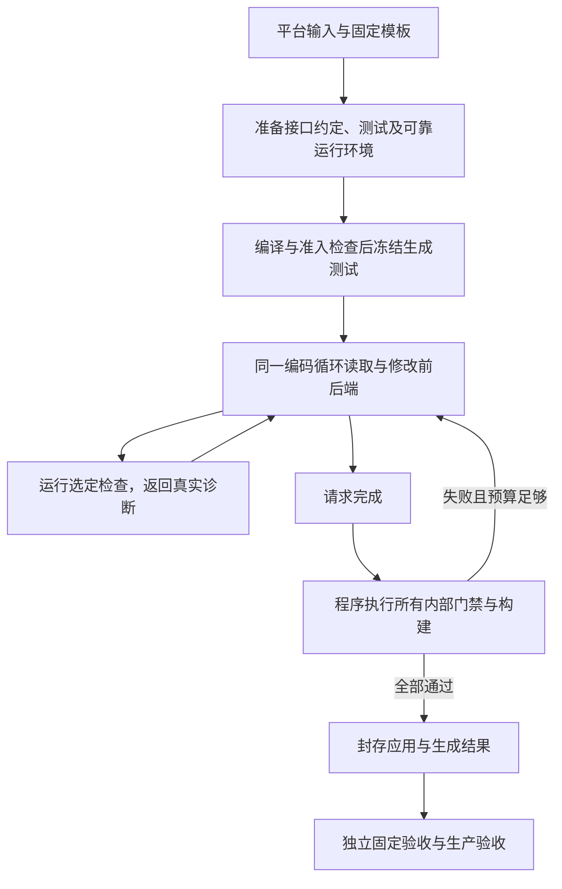

# 简洁编码智能体实施计划

日期：2026-11-02，Asia/Shanghai。状态：核心实现已归档，付费实验按用户要求停止。M1–M4 已实现，M5 同期对照未完成，M6 确认和泛化未执行；候选未晋升，默认仍为 legacy。用户已经撤销此前付费授权，未经重新明确授权禁止模型 API 调用。当前接口归[架构参考](architecture.md)与[操作指南](development.md)，已发生的实验与限制归[对照验证报告](experiments/2026-11-02-单循环编码智能体对照验证.md)。本文保留原设计、验收承诺和版本边界。

目标是在保留严格验收的前提下，用一个能读取代码、局部编辑和执行检查的编码循环生成完整 Web 应用，减少错误中间设计导致的无效修复。优先验证成功交付与包含失败的成本，不把缓存命中率或模块数量作为交付指标。

导航：[平台边界](#平台边界)、[基本架构](#基本架构)、[复用清单](#复用清单)、[可观测性](#可观测性)、[版本控制](#版本控制)、[实施顺序](#实施顺序)。实验设置单独归[候选验证与对照实验计划](experiments/2026-11-02-编码智能体候选验证计划.md)，长期选择归[架构决策](../.agents/notes/proposed/architecture/2026-11-02-单循环编码智能体候选.md)。

## 平台边界

课程侧 `../project_zh.pdf` 第 1 页允许沿用基础仓库或自行设计智能体；第 2–4 页规定入口、输出和模型连接；第 6 页说明评分同时考虑测试通过率和模型开销。该 PDF 的 SHA-256 为 `ad8ecf99e786b35ed31d43711eea4f3ff551bff1b2703e46b63e85c0bc8ca6b2`。这些约定允许改变内部架构，没有要求必须运行 00–12 阶段。

| 边界 | 候选必须保持的行为                                                                                  |
| ---- | --------------------------------------------------------------------------------------------------- |
| 提交 | 上传 Python 智能体 ZIP；`main.py`、`requirements.txt` 同层，包含实际使用的源码、模板和提示词        |
| 入口 | 接受 `python main.py <需求目录> --output-dir <应用输出目录>`；读取实参目录                          |
| 输出 | 输出目录直接包含 `package.json`、`deploy.sh`、`frontend/`、`backend/`，遵守构建、启动与 `PORT` 约定 |
| 模型 | 文本与视觉请求共用平台注入的 `OPENAI_BASE_URL`、`OPENAI_API_KEY`；提供默认模型名，不依赖本地 `.env` |
| 泛化 | 同一版本处理不同需求；登录仅是当前验证任务，不按用户名、任务 ID 或隐藏测试选择答案                  |
| 验收 | 保留类型、后端契约回归、UI 存在性、生成 E2E 和生产构建；当前登录任务另须固定 14 条与生产 14 条通过  |

冻结的老师输入、老师测试与独立断言不修改。当前仓库的阶段冻结规则是我们的版本与对照约定；候选通过独立引擎和回退开关实现，不借改变架构放松门禁。平台资源、时限与工具可用性中尚未核实的部分，在打包验证中记录；本地实验超时不冒充平台限额。

## 现状与可证伪假设

当前基线是十三阶段流水线，文件代理只返回整文件编辑，由程序安排上下文、权限和检查。[已有架构](architecture.md)与[十二次主实验](experiments/2026-11-02-串行消融与缓存验证.md)记录了实现和结果：主实验完整成功 3/12，另外两次 V2 候选均失败，不能据此估计新架构的成功率。

独立审查确认了跨接口会话错配、错误测试、反向 UI 可见性、缺失 binding 和原生 form 关联等反例。新的候选假设是：同一个循环可读取并修改生成应用的前后端，直接观察实际执行结果，能减少跨层错误无法修复和逐事件调用的成本。这是待验证假设；更大的编辑范围也可能造成回归，单循环也可能消耗更多上下文。

## 基本架构

首版采用单进程、单模型客户端、单编辑循环。模板初始化与检查程序由 Python 掌握，模型选择读取、编辑或检查的下一步。保留一个简短实现约定和冻结测试，不再要求 UI 树、事件图与多层 P/Q 成为实现的强制输入。



### 模块与依赖

已新增平铺的 `coding_agent/` 包，以下模块已经存在。没有引入智能体框架、插件注册器、继承层或独立记忆服务；独立评估额外放在 `acceptance.py`，不参与模型修复循环。

| 模块           | 唯一职责                                                   | 主要依赖                   |
| -------------- | ---------------------------------------------------------- | -------------------------- |
| `config.py`    | 读取并冻结路径、模型和预算配置                             | 标准库                     |
| `protocol.py`  | 定义和校验 Action、Observation、CheckResult 的结构         | 标准库与现有 JSON 校验依赖 |
| `model.py`     | 一个模型调用入口，支持文本和图片，记录请求、用量和传输结果 | 配置、协议、记录器         |
| `workspace.py` | 文件读取、搜索、局部编辑和权限检查                         | 配置、协议                 |
| `checks.py`    | 固定检查命令、临时数据库和服务生命周期、结果判定           | 协议、现有进程工具         |
| `trace.py`     | 追加事件和原始附件，重算汇总与封存哈希                     | 标准库                     |
| `loop.py`      | 上下文组装、状态转换、预算和工具调度                       | 上述模块                   |
| `prompts/`     | 一份系统规则与测试准备说明                                 | 随源码打包的文本           |

顶层 `main.py` 只解析入口、初始化模板、选择引擎并返回退出码。`loop.py` 是唯一流程所有者；工具不调用模型，模型客户端不启动应用，日志记录器不决定测试是否通过。首版复用现有模板目录和底层函数，不同时建立第二套模板与公共工具框架。

### 模型动作与文件语义

模型每次返回一个严格 JSON 动作。首版继续使用现有兼容接口的 JSON 响应，不依赖额外的工具调用协议支持。

| 动作     | 执行结果                                                           |
| -------- | ------------------------------------------------------------------ |
| `read`   | 读取指定文件的有限行段或参考图，返回内容、范围、文件哈希与剩余长度 |
| `search` | 在允许的源码范围搜索，返回有限匹配与位置；不读取整个仓库           |
| `edit`   | 批量创建文件或唯一片段替换，返回每个文件的前后哈希与差异           |
| `check`  | 按名称执行 `typecheck`、`backend`、`ui`、`e2e`、`build` 或 `all`   |
| `finish` | 请求执行最终 `all`，不允许模型自行宣布 GREEN                       |

`read/search`、`edit`、`check` 是三类工具，`finish` 是状态请求。所有返回使用同一 Observation 结构，包含 `status`、摘要和完整证据引用。工具参数不接受任意 shell 命令；检查命令以参数数组固定定义。搜索实现有标准库后备，不要求平台额外安装 `rg`。

局部替换使用 `path`、`expected_sha256`、`old_text`、`new_text`，旧片段必须唯一匹配；创建使用 `path`、完整 `content` 和“路径不存在”的前提。整批先校验再写入，写入异常回滚整批，过期哈希与歧义匹配返回明确冲突。测试失败保留已合法应用的修改，并记录对应差异；这不等于测试失败时事务回滚。生成前创建运行标识并独占输出目录。

### 可写范围与上下文

实现阶段允许修改生成应用的前后端业务源码，包括 SQL、API 路由接线、数据库建表清单和 React `App.tsx`。后两类文件在旧流程中由编译器生成，候选必须明确转交给智能体，否则仍会遇到无法修复的接线错误。

输入、冻结测试、测试支持、检查器、依赖锁、平台启动约定和 `.arc/agent/` 记录由程序保护。拒绝越界、软链、大小写别名以及借导入或修改受保护模块绕过测试。静态权限不构成任意生成代码的完整安全沙箱；运行检查仍只使用隔离的数据库和所属子进程。应用子进程不继承模型 Key；适配现有环境合并函数时，验证已删除的凭据不会被重新补回。

模型最初得到原始需求、参考图、技术栈、可访问的教师参考测试、简短接口约定和目录索引；随后按需读取文件。不再按单个事件裁掉状态定义。数据库表、API、会话方式与页面路由约定统一保存在输出目录的 `APP_CONTRACT.md`；它服务于协作，不由编译器从中生成业务事件运行时。模型可以同步这份文档，但冻结测试的期望不随它改变，事实以文件和执行结果为准。

上下文过长时，由程序保留需求与约束、接口约定、最近失败和文件版本索引，去掉过期文件正文及重复成功日志，提示按需重读；不再调用另一个模型摘要。参考图可重新读取，视觉摘要不能覆盖原图。压缩发生时记录保留、删除的消息 ID 和字节数，读文件与工具反馈的截断均显示遗漏数量。

### 测试、检查与退出

同一个智能体先准备少量覆盖关键行为的后端、UI 和 E2E 测试，再冻结进入实现循环。测试准备是粗粒度状态，不再逐需求、逐 API、逐事件创建代理。实现阶段不能修改冻结测试。已有的有效行为断言 RED 要求继续保留：编译、夹具、服务启动或浏览器错误不能当作业务 RED。

测试准入优先使用现有夹具和确定性检查，覆盖“播种会话却没有浏览器凭据”“最后选择值与持久化断言矛盾”等已知反例；具名 fixture 尽量共用于输入和期望。准入不能证明任意生成测试可满足。冻结后证据表明测试错误时，当前尝试以 `INVALID_TEST` 结束；后续另开目录，全部成本保留。首版不建设测试 DSL 或自动解冻系统。

门禁强度按实际覆盖保留，不能只保留同名命令。测试准备时记录需求 ID 与用例 ID 的对应，评估器核对需求中的成功、拒绝和持久化义务；测试数量相同不代表覆盖相同。

| 现有门禁     | 候选的最低验证内容                                                                           |
| ------------ | -------------------------------------------------------------------------------------------- |
| 类型检查     | 编译全部前后端源码与冻结测试，检查导入大小写；不能只编译入口                                 |
| 后端契约回归 | 请求、响应与真实隔离 DB 的必要写入/禁止写入；有关联的接口实际组合使用                        |
| UI 存在性    | 从原始需求核对标签、角色、路由、控件与规定状态；使用真实页面与动作，不依赖旧 UI fixture 注入 |
| 生成 E2E     | 原生页面动作到后端、数据库和刷新后结果，覆盖规定的成功与拒绝；不以单独测试 handler 代替      |
| 构建         | 实际构建前后端，验证生产启动和平台端口；当前任务另在生产应用执行完整固定验收                 |

`CheckResult` 统一包含检查名、应用与测试哈希、退出码、通过/失败/跳过/预期失败/重试后通过数量、运行器错误、诊断附件与耗时。成功要求实际执行且非空、退出码为零、无失败、skip、todo、flaky、预期失败伪通过或运行器错误。缺少测试与报告损坏返回 FAILED/UNKNOWN；不得用空集合满足全部通过。

最终 `all` 强制重跑所有内部检查与构建，不因早先缓存的 GREEN 跳过。门禁记录必须绑定当前应用与测试哈希。当前登录任务的独立固定 14 条和生产 14 条由外部评估器在生成结束后执行；结果不回流给本次智能体继续修复。其他任务使用各自预先冻结的独立验收，不能套用登录的 14 条。

首版只设置全局轮数、token 与时间预算，检查和模型调用消耗同一剩余时间。相同失败指纹且相关代码、检查结果连续三次无进展时，以 `NO_PROGRESS` 停止并给出最后差异；不同错误和有效进展不被粗暴合并。`INTERNAL_GREEN`、`FAILED_CHECK`、`INVALID_TEST`、`NO_PROGRESS`、`BUDGET_EXHAUSTED`、`TRANSPORT_FAILED`、`INTERRUPTED` 分开记录；预算耗尽永不记为成功。首版不自动恢复中断任务，保留证据后新开目录。

## 复用清单

“直接复用”指保留源码所有权和已验证行为，不表示复制后无需回归。适配从小函数开始，避免对旧库做通用化重构。

| 现有资产                          | 位置                                                               | 复用方式与边界                                                                                                                        |
| --------------------------------- | ------------------------------------------------------------------ | ------------------------------------------------------------------------------------------------------------------------------------- |
| React/Express/SQLite 骨架         | `infrastructure/shared/project/templates/`、`initialize.py`        | 直接复用目录与初始化；保留实际服务器、数据库 client 和测试支持导出；用小型确定性准备函数配置 Playwright/Tailwind，不调用旧 UI IR 接线 |
| 构建与部署约定                    | `main.py`、模板 `package.json`、后端复制 SQL 脚本                  | 复用命令与 `PORT` 行为；候选部署脚本由程序生成并保护                                                                                  |
| 模型连接、原始 usage 与 HTTP 观察 | `shared/models/{text,vision}.py`、`utils/presentation/model_io.py` | 复用传输经验与字段；统一一个客户端、默认模型名、平台端点和 Key；严格解析 JSON，移除截取首对象的容错                                   |
| 路径与批量写入防护                | `shared/agent/files.py`、`utils/paths.py`                          | 复用路径检查和写入异常回滚；改为局部编辑，不照搬“只能创建一个目标文件”或旧层权限集合                                                  |
| 反馈精确去重                      | `shared/agent/loop.py`                                             | 复用去 ANSI 与可证明相等的重复删除；保留关键错误和截断标记                                                                            |
| 进程、端口和临时 DB               | `utils/processes.py`、`interactions/e2e_runtime.py`                | 复用所属进程清理与隔离策略；适配无模型凭据的子进程环境                                                                                |
| 浏览器与后端检查执行              | `backend/testing.py`、`ui/testing.py`、`interactions/testing.py`   | 复用执行和解析函数；统一严格 GREEN，移除旧 UI fixture/IR 的强依赖                                                                     |
| 计时与模型用量汇总                | `utils/timing.py`、`scripts/summarize_*`                           | 复用单调时钟、层级耗时与 SDK 只计一次原则，增加动作和修改关联                                                                         |
| 老师测试、独立断言                | `input/tests/`、`acceptance/`                                      | 原字节保留，模型只见任务提供的参考测试；独立固定断言不进入生成上下文                                                                  |
| 历史对照与审计                    | `scripts/run_factorial_campaign.py`、`audit_factorial_campaign.py` | 复用隔离目录、失败保留、身份记录；只借鉴流程，修复缺失 usage 与生成源码未核验等漏洞                                                   |

不迁入候选核心：00–12 编排、UI 树与事件运行时生成、多套 P/Q/义务传播 IR、逐事件调用、旧 UI checkpoint、V1/V2 缓存排序与复杂恢复。它们继续存在于 legacy 对照路径，历史文档和负结果保留。传输重试只保留一处有界调度，避免 SDK 与外层倍增；自然形成的前缀缓存照常计量，首版不专门调缓存排序。

### 验收适配是首个技术关口

[现有固定验收脚本](../scripts/accept_teacher.py)从 `.arc/db_schema.json`、`backend_apis.json`、`backend_contracts.json` 推断适配信息，并读取三个阶段报告。[固定夹具](../acceptance/context.ts)还导入模板中的数据库初始化和哈希辅助函数。因此不能直接复制旧脚本，也不能为了兼容而伪造旧 IR 或写三个 GREEN 文件。

候选新增薄的评估入口，复用原字节老师测试、独立断言与相同的浏览器/数据库夹具。位置、表字段和 Cookie 名等适配信息只负责定位，不改变期望；由真实 SQLite schema、外键和网络交付证据核验，不能让模型定义“应当通过什么”。保留模板导出路径；新入口从真实统一 CheckResult 判断内部完成，不再依赖阶段名称。适配器属于评估器，不参与修复循环。

付费比较前，对同一个历史成功应用证明旧、新评估入口的 14 条结果一致；再在临时副本中分别制造 Cookie 错配、重复用户名显示与数据库多写，证明双方均拒绝。独立断言内容和测试用例身份必须完全一致。未完成这一关，只能验证工具和架构，不能宣称性能或成功率可比。

## 可观测性

首版保留 JSONL 和附件，不建设仪表盘、数据库或分布式追踪服务。运行结束后，用户应能回答：哪次调用改了什么、哪个检查首次失败、是否有进展、花费在哪里、当前源码是否仍是当时受测版本。

已在应用输出的 `.arc/agent/` 保存：

```text
run.json                 # 输入、源码、模型、配置、依赖与冻结测试身份
events.jsonl             # 一份按序追加的运行事件
artifacts/               # 原始模型响应、检查报告、浏览器证据与编辑差异
artifact-manifest.json   # 封存时的文件哈希清单
result.json              # 从事件、原始用量和实际门禁派生的终态
```

事件公共字段为 `schema_version`、`run_id`、`seq`、UTC 时间、单调时钟偏移、`kind`、`turn`、`call_id/action_id/check_id`、状态与附件引用。附件记录 SHA-256；原始大正文不反复塞进摘要。模型原始请求/响应、HTTP 尝试、合法或拒绝的动作、文件前后哈希、检查开始/结束、上下文压缩、预算触发和最终封存都要有事件。

| 必须能看到的内容                     | 实现约束                                                                                   |
| ------------------------------------ | ------------------------------------------------------------------------------------------ |
| 模型输入、输出、截断、拒绝和传输失败 | SDK 原始响应保留；HTTP 重试是尝试事件，不重复累加 SDK response usage                       |
| token、命中、未命中与输出            | 字段缺失记 unknown/null；不将缺字段视为零，不把总 token 当账单金额                         |
| 修改与失败的关系                     | 检查引用受测应用版本和前序编辑；报告失败用例、定位与首次出现动作，不能用最后文件名代替根因 |
| 浏览器问题                           | 页面异常、请求失败、失败测试 trace/截图；同源凭据组合用实际浏览器验证                      |
| 时间与成本                           | 单独报告模型、检查、安装、构建及完整 wall time；父子 span 不相加冒充总耗时                 |
| 审计完整性                           | 开始/结束不配对、重复响应、缺失用量或附件哈希变化时，证据状态为 INCOMPLETE/INVALID         |

模型 Key、Authorization、原始环境转储不进入记录。浏览器凭据与数据库内容只存必要的本地诊断附件，分享摘要脱敏；默认不记录 Cookie 值。封存顺序为停止应用写入与所属服务、写终态事件并关闭日志、计算源码/测试/配置/原始日志哈希、最后写 manifest 与 result。清单不包含自身和 result，result 引用清单哈希，避免自引用。评估器启动前与结束后重验受测文件，运行后编辑必须使审计失败。

## 版本控制

唯一源码仓库仍是 `notes/4810/lab6/source/` 的独立 Git。外层 JI 的提交不能代替它。原提案记录于 `perf/controlled-ablation`，计划提交为 `c5ddb5d`；原目录两份用户未提交文档修改继续保留。开发位于独立 `feat/coding-agent-v2` worktree；正式受测源码使用另一个固定提交的 detached worktree，文档整理不改变受测目录。

| 身份             | 固定方式                                                       | 用途                                               |
| ---------------- | -------------------------------------------------------------- | -------------------------------------------------- |
| 教师原始源码     | `teacher-baseline`，`bc4b83b147264572aeec125a1fd46a2943ced312` | 历史源码起点，不宣称是同条件实测基线               |
| 历史主实验基线 A | `e910eed1c3debc779d9308205e274f9b677ececf`                     | 新实验重新运行的 legacy 对照；旧 12 次只作历史证据 |
| 候选开发 B       | `feat/coding-agent-v2`，从 `c5ddb5d` 建立独立 worktree         | 实现、离线验证与文档维护                           |
| 受测候选         | 评估协议登记完整 SHA，独立 detached worktree                   | 禁止边测边改                                       |
| 默认交付版本     | 完成确认实验与打包检查后另行晋升                               | 不因一次成功或局部命中提高而切换                   |

实现通过唯一新开关 `ARC_AGENT_ENGINE=legacy|coding` 选择，首次引入默认 `legacy`。旧编号阶段不改语义，`coding` 进入新包；现有旧优化开关只控制 legacy，不渗透到新引擎。回退只需选择 legacy 或检出固定基线，新旧引擎使用不同输出目录，不能混用 checkpoint。新开关和语义边界写入 proposed Note，实际实现和验收完成后再更新状态。

分支隔离已实际执行。后续建立新候选时可沿用以下形式；`PLAN_SHA` 替换为对应起点：

```sh
git worktree add -b feat/coding-agent-v2 ../work/coding-agent-v2-source PLAN_SHA
```

按里程碑提交，使用 `docs(agent): ...`、`feat(agent): ...`、`test(agent): ...`、`fix(agent): ...`；不要把候选代码、测试变弱和性能调参混进一个提交。实验只接受干净的受测 worktree。协议和摘要提交到 `docs/experiments/`，大日志与产物留在隔离的 `../work/`，来源、哈希与失败目录必须可定位。

现有仓库没有 remote，验证里程碑后按[维护指南](maintenance.md)导出 Git bundle 并验证恢复；不能把本地 commit 当远端备份。备份导出不得覆盖用户未提交编辑，外层归档与本计划分开处理。上传 ZIP 和源码备份分开：ZIP 不含 `.git`、`.env`、依赖、旧结果、其他课程内容；保存包哈希和对应完整提交号，并在空目录验证真实上传包。

## 实施顺序

| 顺序 | 交付与建议提交                                                                      | 完成条件                                                                                            |
| ---- | ----------------------------------------------------------------------------------- | --------------------------------------------------------------------------------------------------- |
| M0   | 文档与 proposed Note；`docs(agent): plan a minimal coding agent candidate`          | 计划、复用范围、回退、实验与来源可审查；不改现有执行行为                                            |
| M1   | 配置、动作、工作区和记录；`feat(agent): add scoped tools and run records`           | 无模型网络的反例通过：越界/软链/过期编辑/写入回滚/缺失 usage/哈希变化；默认模型与同一端点规则有测试 |
| M2   | 检查与独立评估适配；`test(agent): preserve checks across both engines`              | 所有内部门禁严格；固定 14 条旧、新入口对同一应用等价，正负控制通过，不改冻结断言                    |
| M3   | 单循环、上下文和预算；`feat(agent): add the bounded coding loop`                    | 脚本化假模型跑通“跨前后端修复→回归”；三次无进展、预算耗尽、错误测试和中断均正确终止；无真实模型调用 |
| M4   | 入口开关与打包；`feat(agent): expose the candidate through the platform entrypoint` | 默认仍走 legacy；空目录、无 `.env`，只注入平台变量，使用本地假接口验证上传包闭环与 `PORT`           |
| M5   | 有预算的候选筛查与架构对照                                                          | 已按用户要求停止；保留已发生的实验与成本，禁止自动继续付费生成                                      |
| M6   | 确认实验、恢复验证和默认版本决策                                                    | 通过预先登记的全部条件才晋升；负结果保留，不能只改 Note 状态宣布完成                                |

M1–M4 只做与新能力相关、能发现实际失效的测试，不补镜像实现的数量型测试。实现时先保持平铺模块，出现真实的第二个调用方或第二种运行后端再提取公共接口；新增任务优先增加输入和验收夹具，不增加一套智能体。首版延期项为多智能体、插件系统、RAG 服务、自动上游重编译、DAG 恢复、LLM 记忆摘要和专门缓存排序。

M2 评估正负控制、M3 脚本化跨层修复和 M4 真实 ZIP 解压/假接口/生产 PORT 已通过。浏览器失败 trace/截图按检查分别留存，后续运行不覆盖；编辑工具支持同文件多处原子替换，业务 CSS 可编辑而 Tailwind 导入受保护。压缩事件采用消息条数和完整原始请求快照重建上下文，没有额外建立逐消息 ID 存储；逐消息字节统计未作为已完成的测量指标。

M1–M4 的通过不代表架构收益成立。具体预算、样本数、停止规则和晋升限制仍由[实验计划](experiments/2026-11-02-编码智能体候选验证计划.md)唯一维护，实际结果归实验报告；原有失败与评估错误保留，不回填成成功。
