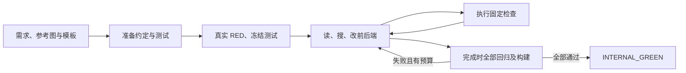

# 架构

两种引擎共享平台入口：读取传入需求目录中的 YAML、参考图与附带测试，向指定输出目录生成 React/Express/SQLite 网站。源码默认 legacy，`ARC_AGENT_ENGINE=coding` 选择候选；上传包固定所选引擎。

## legacy：分阶段设计与实现

`main.py → run_all.py → legacy/00–12` 顺序执行，阶段间用输出目录下的 `.arc/*.json` 传递中间表示。

| 阶段  | 行为                                                | 产物                                      |
| ----- | --------------------------------------------------- | ----------------------------------------- |
| 00    | 初始化应用模板                                      | 前后端骨架                                |
| 01    | 解析需求树、视觉分析参考图                          | requirements、visual_analysis             |
| 02–05 | 设计数据库、推断并校验读写义务、实现 SQL            | schema、obligations、建表与初始化代码     |
| 06–08 | 拆 API、生成前后置契约、冻结测试后实现              | backend_apis、backend_contracts、后端源码 |
| 09–10 | 按叶子需求设计页面与绑定，生成存在性测试并实现      | ui_design、页面与 UI 检查                 |
| 11–12 | 拆触发器与事件契约，冻结 E2E 后逐事件实现及最终回归 | ui_interactions、事件处理器、E2E          |

模型负责设计与代码提案；程序校验形状、字段读写集合、可写文件和真实测试结果。局部编码循环接收允许修改的文件，运行 gate 后把错误反馈给模型。单事件创建使用较小上下文，每个需求的最终修复仍拥有完整页面、事件和冻结测试上下文。

分阶段权限有助于定位错误，也限制跨层修复：前端无法修复被冻结的后端协议或错误测试。义务守恒只证明中间表示一致，不证明自然语言推断与业务实现正确。完成记录与局部 checkpoint 分离，续跑仅复用同一输入、源码、配置及工作区下有成功证明的连续阶段。

## coding：整个应用共用一个编码循环

`main.py → coding_agent/loop.py` 直接控制整个前后端，不依赖旧 UI/事件中间表示。模型先准备 `APP_CONTRACT.md`、SQL 与三个测试文件，程序验证类型、准入和真实断言 RED，然后冻结测试，再进入实现循环。

同一个模型按需读取文件、搜索、提交编辑并请求检查。已有文件编辑使用 SHA-256 与唯一片段替换，整批验证后写入，异常恢复原字节。输入、冻结测试、依赖、检查支持、服务器骨架和运行记录受程序保护；工具不接受任意 shell 命令。

参考图在每轮请求中保留；可只读查看列出的浏览器诊断与失败截图。模型可把输入图片原字节复制到新的 `frontend/public/assets/`，路径与软链受检查，正文和控件仍需真实实现。历史超过阈值后保留近期消息，原始请求仍记录用于审计。

统一轮次、token 和时间预算控制停止；重复不变动作停止，冻结后发现错误测试以 `INVALID_TEST` 结束。模型不能自行发布 GREEN，最终检查必须全部绑定相同应用指纹。更大的可写范围也可能引入回归，不能据此推断成本更低。

## 完成、隔离与评估

两个引擎都保留 typecheck、后端测试、UI 存在性、生成 E2E 与生产构建。跳过、空套件、flaky 和预期失败不算通过。legacy 最终由 `main.py` 初始化数据库、构建并写出 `deploy.sh`，coding 在完成检查中生成同样的部署产物。

平台初始输出可以非空：统一入口在独立临时目录执行完整生成，成功后将原内容备份并交付到平台指定目录根层，保留目录本身与 `.git`。失败保留原目录及独立工件，已有编译记录仍拒绝当作初始模板。

每次运行使用独立工作区、数据库和所属进程；中断只清理自己创建的进程树。应用子进程剥离模型凭据；文件边界与进程治理不等于容器安全沙箱。

独立评估位于 `scripts/evaluation.py`：在临时副本上原字节执行教师四条与固定十条验收，开发、生产各执行一次；依据真实 schema、Cookie 与浏览器交付映射字段，未知必填项拒绝猜测。评估不向模型反馈固定十条断言，不修改原应用。行为通过仍需单独检查视觉还原，当前 14 条没有视觉相似度指标。

`.arc/agent/` 保存 coding 原始调用、事件、检查、编辑与封存清单；legacy 使用阶段工件、`model_calls.jsonl` 与 `timings.jsonl`。审计只统计实际返回 usage，未返回请求用量保持未知。配置与操作见[开发指南](development.md)，已有结果见[结果摘要](results.md)。
