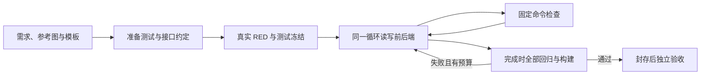

# 架构参考：需求编译器（Lab 6 改良版）

本文回答「编译器整体怎么工作、每个阶段吃进吐出什么、哪些是模型哪些是确定性代码」。
运行方式见 [development.md](development.md)；逐阶段 token 度量见
[experiments/2026-11-01-baseline-optimization.md](experiments/2026-11-01-baseline-optimization.md)。

## 总体形态

两种引擎都把 `requirements.yaml` 与参考截图转换为 React/Express/SQLite 网站。
源码默认 `legacy`；`ARC_AGENT_ENGINE=coding` 显式选择单循环候选。上传候选包通过
`engine.json` 选择 coding，不要求平台配置额外开关。默认版本的晋升由完整实验决定。

legacy 的 13 个阶段脚本（`00`–`12`，`run_all.py` 顺序执行）共享输出目录下的 `.arc/*.json` 工件链；
每个阶段的输出是下一阶段的输入，链路逐层可追溯。

## 单循环候选

`main.py` 选择引擎后，`coding_agent/loop.py` 独占流程控制。同一个模型先准备简短的
`APP_CONTRACT.md`、SQL 和三个测试文件；程序检查类型、测试准入与真实断言 RED，
冻结测试字节，再让同一个循环实现整个前后端。模型可请求读、搜、改、检查和完成，
不能自行发布 GREEN。没有多智能体、插件框架、旧 UI 事件运行时或额外摘要模型。

核心平铺为配置、协议、模型客户端、文件工具、检查器、记录器和循环七个模块，另有一份
系统提示词。`acceptance.py` 属于独立实验评估，不作为生成工具，也不把固定十条断言
反馈给模型。程序复用原模板、Tailwind/Playwright 配置、路径检查、进程治理和结果解析，
新增真实 Express/内存 SQLite HTTP 夹具，保留稳定的数据库初始化与密码夹具导出。

| 边界     | 当前行为                                                                                                        |
| -------- | --------------------------------------------------------------------------------------------------------------- |
| 编辑     | 新文件完整创建；已有文件按 SHA-256 和唯一片段替换；同文件多处替换按顺序暂存，整批验证后写入，写入异常恢复原字节 |
| 业务源码 | 冻结后可改 API 接线、SQL、初始化清单、React 入口组件和样式；`style.css` 必须保留 Tailwind 导入                  |
| 程序保护 | 输入、冻结测试、夹具、依赖与检查配置、服务器骨架、部署约定及运行记录；不接受任意 shell 工具                     |
| 完成     | typecheck、真实后端测试、UI、生成 E2E、生产构建全部有非空 GREEN；skip/todo/flaky/预期失败不算通过               |
| 停止     | 统一轮次、token 和时间预算；重复不变动作三次停止；冻结后发现错误测试则终止，不通过改测试修绿                    |
| 环境     | 每次新输出、隔离数据库和所属服务；应用子进程删除模型凭据；这不是任意生成代码的完整安全沙箱                      |

需求、接口约定和文件索引始终在上下文中；文件按需读取，历史超过阈值时保留最近十条
消息并记录压缩。参考图以不可变消息保留在每一轮请求中，历史压缩也不会移除；也可重新读取。局部检查失败保留合法修改，最终完成
重新执行全回归；所有最终检查绑定相同应用指纹。内部门禁不证明模型生成测试足够完整。

`.arc/agent/` 保存身份、按序事件、原始请求/响应与检查报告、编辑差异和封存清单。
每轮记录阶段，模型调用、HTTP 尝试、检查及进程都可关联。失败浏览器 trace/截图复制到
独立附件目录，后续检查不覆盖。模型可只读访问列出的 `error-context.md` 与失败截图，不能编辑诊断附件或读取模型请求/响应日志。审计重算原始 SDK 用量并检测未配对调用、重复响应、
源码和证据变化；缺失用量保持未知。完整成功还须通过外部开发和生产验收。

评估器原字节运行老师四条与独立十条断言。它用 SQLite schema/外键和真实注册的浏览器
交付来定位表、字段、Cookie 与会话路径，不生成旧 IR 或旧 GREEN。SHA-256 会话摘要
必须由实际 Cookie 与存储值匹配证明；时间戳元数据来自真实注册，未知必填业务字段拒绝
猜测。适配器只转换位置和存储编码，固定身份、断言和数据库比较语义保持不变。

行为通过与视觉还原分别报告：现有 14 条检查不会证明布局与参考图接近。独立诊断已发现
行为全绿但 CSS 缺失的例子，因而不能把 INTERNAL_GREEN 当作视觉签收。

## 阶段与工件链

| 阶段  | 工作                                      | 主要产物（`.arc/`）                       | 模型       |
| ----- | ----------------------------------------- | ----------------------------------------- | ---------- |
| 00    | React/Express/SQLite npm workspaces 骨架  | project/report.json                       | 否         |
| 01    | 需求树解析 + 视觉分析参考截图             | requirements.json、visual_analysis.json   | 是（视觉） |
| 02    | 数据库实体/字段/关系                      | db_schema.json                            | 是         |
| 03–04 | 字段级读写义务推断 + 守恒校验             | db_obligations.json                       | 03 是      |
| 05    | 建表 SQL 与初始化代码                     | backend/src/db/tables/*.sql               | 是         |
| 06–07 | 后端 API 拆分 + P/Q 契约                  | backend_apis.json、backend_contracts.json | 是         |
| 08    | 契约冻结为测试（RED）→ 实现（GREEN）      | backend_tdd.json                          | 是         |
| 09    | 页面/元素/绑定/显示状态设计（增量 + RAG） | ui_design.json                            | 是         |
| 10    | 存在性测试 + 页面实现                     | ui_checks.json                            | 是         |
| 11    | 触发器/事件/事件契约                      | ui_interactions.json                      | 是         |
| 12    | 逐需求 E2E 冻结 → 逐事件实现 → 回归       | frontend_e2e.json                         | 是         |

## 关键机制

- **文件编辑协议**（`infrastructure/shared/agent/`）：模型返回
  `{"edits":[{path,content}]}` 整文件批编辑；`FileWorkspace` 校验路径合法性、
  原子写入失败回滚、每次请求重新供给文件内容。`run_file_agent` 是有界修复循环：
  生成 → gate → 失败反馈 → 重试。
- **义务守恒**：叶子需求与分配 API、交互调用的字段级 R/W 集合保持一致；
  04 号脚本检查义务记录和字段引用，06/11 比较分配集合。这不证明自然语言义务推断或业务实现本身正确。
- **契约冻结测试**：08/12 先把 P/Q 与场景冻结为可执行测试（RED），实现以
  通过冻结测试为完成定义——模型没有"我觉得做完了"的话语权。
- **确定性接线**：工件校验、运行时接线和测试执行由代码完成；数据库、API、页面与事件提案依赖模型。
- **失败语义**：单阶段失败由 `guarded` 转为警告继续（部分阶段）或中止流水线；
  `run_all.py --resume` 按可信成功前缀恢复；完成记录与局部 checkpoint 分离，08/10/12 检查成功状态。输入/编译器/配置指纹与整体工作区哈希不符时拒绝复用，要求新目录，尚无最小 DAG 增量重建。详见 [恢复规则](development.md#可信断点续跑与旧目录迁移)。

## 性能优化落点（详见实验报告）

| 优化                           | 位置                                               | 触发/回退                                                                  |
| ------------------------------ | -------------------------------------------------- | -------------------------------------------------------------------------- |
| Stage 12 创建调用上下文瘦身    | `interactions/implementation.py`                   | `ARC_FULL_CONTEXT=1` 回退                                                  |
| 进一步单事件上下文收窄         | `interactions/creation_context.py`                 | `ARC_EVENT_CONTEXT` 默认 1，=0 回退；固定次数复测未建立稳定成功率/提速收益 |
| 共享前缀排序与 V2              | `shared/models/context_order.py`                   | `ARC_CACHE_PREFIX` 默认 1；V2 默认 0，局部复用改善但完整验证未通过         |
| agent 反馈去噪（ANSI/截断）    | `shared/agent/loop.py`                             | 常开                                                                       |
| 瞬态传输退避重试               | `shared/models/text.py`                            | `ARC_MODEL_TRANSPORT_RETRIES`                                              |
| Stage 09 逐需求设计 checkpoint | `frontend/ui/synthesis.py`                         | `ARC_UI_DESIGN_FRESH=1` 全新                                               |
| 流水线断点续跑                 | `run_all.py`、`utils/pipeline_state.py`、`main.py` | `--resume`；`ARC_LEGACY_PIPELINE_RESUME=1` 回退                            |

## 仓库布局

- `00`–`12_*.py`：阶段脚本（教师内容，语义冻结）
- `infrastructure/`：编译器库——`shared/agent`（编辑协议与循环）、`shared/models`
  （text/vision 客户端）、`stages/*`（各 pass）、`shared/rag`（页面检索）、`utils`、`project/templates`
- `input/`：按教师 ZIP 原字节冻结的需求、截图与原始 E2E；pending 扩展在 `examples/registration-pending/`
- `tests/`：编译器单元测试（含文件编辑、流程与反馈回归）
- `coding_agent/`：单循环候选与独立评估入口；核心不依赖旧阶段 IR
- `main.py`：平台入口；legacy 执行 run_all，coding 进入新循环，两者产物均遵守平台启动约定

历史成本剖析与候选方向见 [整体优化审阅](2026-11-01-整体优化审阅.md)，最新固定次数结果见[串行消融与缓存验证](experiments/2026-11-02-串行消融与缓存验证.md)。JSON 形状/义务校验、行为测试与固定外部验收分别承担不同职责，不把任一 IR 检查称为完整业务证明。
