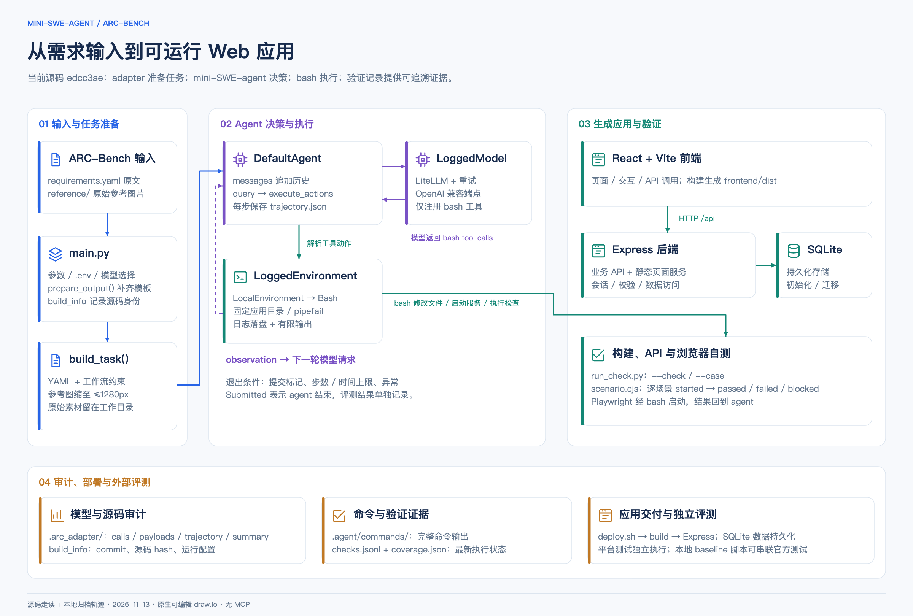
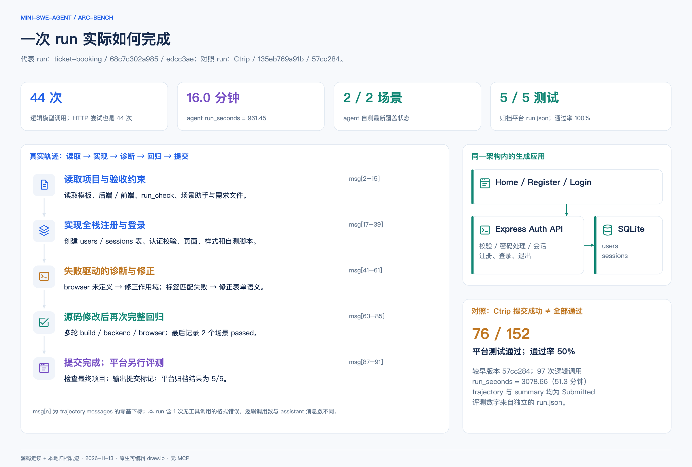

# mini-SWE-agent → ARC-Bench 架构与运行轨迹

图基于当前 `edcc3ae` 源码和本仓库归档的真实运行产物。绘图直接生成本地 XML，不使用 MCP。两页原生图在 [适配器架构与运行轨迹.drawio](2026-11-13-适配器架构与运行轨迹.drawio) 中；节点、文字、分区和连线可单独编辑，图标为嵌入文件的自绘 SVG，不依赖外部图片地址。

## 系统架构

`main.py` 负责解析参数、读取环境配置和写入构建身份。`arc_adapter.prepare_output()` 验证 YAML，只补齐输出目录里缺失的模板文件，并把输入素材复制到 `.arc_requirements/`。`build_task()` 把完整 YAML 和工作流约束交给 agent，同时压缩并附加参考图。原始参考图片保留在工作目录。

`engine_source.py` 把仓内 mini-SWE-agent 源码置于导入路径首位。`run_agent()` 组合 `DefaultAgent`、`LoggedModel(ModelProgress, LitellmModel)` 和 `LoggedEnvironment(BashProgress, LocalEnvironment)`。`DefaultAgent` 维护消息历史，循环请求模型并执行工具动作。LiteLLM 只向模型提供 bash 工具；文件修改、应用构建、API 检查和 Playwright 检查均经 bash 发起。模型没有独立的浏览器或文件编辑工具。

`LocalEnvironment` 在应用根目录执行独立 bash 命令，启用 `pipefail`，把完整输出写入 `.agent/commands/`，向模型返回有限输出和日志路径。超时会清理该命令的进程组；正常完成时保留显式启动的后台服务。提交标记、上限和异常决定 agent 何时停止。

生成应用以 React/Vite 为前端，Express 为后端，SQLite 为持久化存储。Express 提供业务 API，并在前端构建存在时提供静态资源与页面入口。`deploy.sh` 负责安装、构建和启动。模板中的业务 API 注册器本身为空；图中的业务实现由运行中的 agent 填充。

审计记录有不同用途：`.arc_adapter/` 保存模型调用、请求增量、轨迹和汇总；`.agent/` 保存命令日志与检查证据。`run_check.py --check` 记录构建或后端命令；`--case` 要求场景事件，由 `scenario.cjs` 输出开始及结果。`coverage.json` 采用最新执行状态，命令退出成功不能代替场景通过证据。

独立平台评测位于应用交付之后。`scripts/run_keep_baseline.sh` 是本地串联生成、部署和官方 Playwright 测试的入口，不能据此推断平台内部使用相同启动流程。

## 真实 run

### Ticket-booking：当前版本的完整例子

归档目录：`results/edcc3ae/smoke/ticket-booking/2026-11-12_02-09-35+0800__68c7c302a985-template/`。源码身份为 `edcc3ae`，agent 最终状态为 `Submitted`；44 次逻辑调用，44 次 HTTP 尝试，运行 961.45 秒。

下标均指 `trajectory.json` 中 `messages` 数组的零基位置，不是调用次数。

| 消息下标 | 轨迹内容 |
|---|---|
| 2–15 | 阅读项目、模板、检查助手、需求文件和环境能力。 |
| 17–39 | 实现用户与会话表、密码及会话处理、认证 API、页面、样式和自测。 |
| 41–47 | 首次浏览器检查失败；日志报 `ReferenceError: browser is not defined`，随后修改测试脚本作用域。 |
| 49–53 | 继续检查时出现表单标签匹配问题；修改 label 的语义关联后，两场景通过。 |
| 55–61 | 增加表单约束和补充探测，处理探测中的导航同步问题。 |
| 63–85 | 继续修改源码并执行多轮构建、后端和浏览器回归。最后检查分别为 `check-12rj5nvz`、`check-j4bsveg5`、`check-6kskf_z5`。 |
| 87–91 | 查看最终文件及端口；一次无工具调用的格式错误被反馈后，以独立 bash 命令提交。 |

归档里有 43 条 assistant 消息，逻辑调用为 44 次；无工具调用的响应走格式错误处理，不能用 assistant 消息条数替代调用统计。最新自测覆盖为 `SCN-REQ-1-01` 与 `SCN-REQ-2-01` 均通过；最终后端输出为 4 个测试通过。平台 `run.json` 另行记录 5 个测试通过、0 个失败。这三种计数使用不同口径。

### Ctrip：提交和验收的区别

对照目录：`results/57cc284/practice/ctrip/2026-11-12_13-22-17+0800__135eb769a91b-template/`。这是较早的 `57cc284` 版本，不能作为当前代码已执行同样行为的证明。

该 run 完成 97 次逻辑调用，运行 3078.66 秒，轨迹和 adapter 汇总均记录 `Submitted`。归档平台 `run.json` 却记录通过 76、失败 76，通过率 50%。因此，架构图把 agent 的结束条件和外部评测分开表示。轨迹中可见完整应用实现、浏览器探测、多轮修复和回归，但提交状态本身不足以证明所有需求通过。

## 证据与复现

[运行证据.json](2026-11-13-运行证据.json) 保存 run 身份、版本、汇总指标、覆盖状态和证据文件路径，未复制模型内部推理文本。各统计来源为已有归档；没有重新运行模型、应用或平台测试。

源码入口：`main.py`、`arc_adapter.py`、`engine_source.py`、`progress.py`、`vendor/mini-swe-agent/src/minisweagent/{agents/default.py,models/litellm_model.py,environments/local.py}`、`web_template/scripts/{run_check.py,scenario.cjs}`、`web_template/backend/src/app.ts` 以及 `scripts/run_keep_baseline.sh`。

运行 `python3 docs/architecture/build_diagrams.py` 可从统一场景描述重新生成 `.drawio` 与两张 SVG。PNG 是这些 SVG 的浏览器渲染预览。手动编辑 draw.io 文件后，不应直接运行生成器覆盖修改；需同步修改生成脚本或另存图文件。交付前检查 XML 结构、节点唯一性、连线几何及两页预览；尚未使用 draw.io Desktop 对导入后的外观进行复核。
