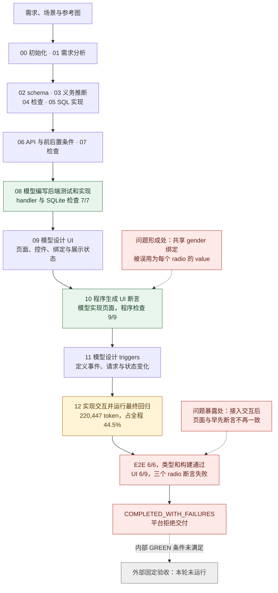
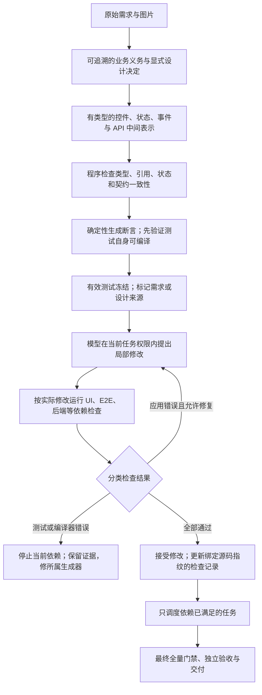
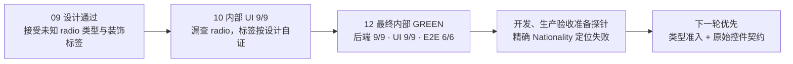

# 从运行失败到 compiler 重构

Status: 第一轮已知缺陷在组合验证中修复，内部检查与开发/生产固定十四条均通过；修正版本从头完整生成与稳定性确认尚未执行。默认引擎 compiler。更新日期：2026-11-05。

这个项目让智能体读取网站需求与参考图，生成 React 前端、Express 后端和 SQLite 数据库。模型负责提出设计、编写测试和代码；Python 编排器把工作分阶段执行，并调用 TypeScript、测试和构建工具检查结果。**我们已经能生成应用，但还没有稳定地交付满足完整验收的应用。** 重构从已经发生的运行失败出发：解释错误如何形成、为何局部通过仍会失败，再选择教师、同学和 legacy 中适用的实现。

改进采用累计迭代：教师更新、同学补丁、legacy 经验和我们的机制设计共同构成每一阶段的版本，不拆分“整合收益”和“自主收益”。代码来源仍逐项记录，用于维护和复核；运行结果只评价该阶段整体是否更接近完整交付。计划为**三轮改进、一次最终复跑，共四轮新的完整生成**，已有 baseline 作为起点，不重复运行旧版。

阅读顺序：[当前执行到哪一步](#current-progress) → [失败过程与动机](#motivation) → [对应改动](#changes) → [阶段安排](#iterations)。完整成绩与条件归[结果摘要](results.md)，当前实现归[架构](architecture.md)，详细源码 diff 和测试索引保存在仓库内 gitignored 的 `work/`。

<a id="current-progress"></a>

## Current Progress：能生成应用，但未稳定完成交付

### 一次生成并不是一次模型回答

输入是需求描述、Given/When/Then（已有条件、用户动作、预期结果）场景和页面参考图。以注册、登录任务为例，智能体需要先决定账户与会话如何存储，再设计注册、登录、查询会话等接口，随后生成页面，最后把输入、点击、HTTP 请求和页面状态连接起来。

当前流水线按需求逐步扩充同一个应用。模型提出 JSON 设计或文件修改，编排器校验并运行对应检查；失败反馈会进入后续模型调用。因此，某个阶段显示 GREEN，只说明它当时运行的检查通过，不代表整站已经满足原始需求。

| 检查      | 谁产生测试或期望               | 实际覆盖范围                                                                  |
| --------- | ------------------------------ | ----------------------------------------------------------------------------- |
| 后端 TDD  | 模型依据 API 契约编写测试      | 本轮直接调用 handler（请求处理函数），并使用真实 SQLite；不是完整 HTTP 路由链 |
| UI 存在性 | 编排器把生成的 UI 设计转成断言 | 控件、文本、属性和展示 fixture（测试预置数据）是否符合设计                    |
| 生成 E2E  | 模型依据场景编写浏览器测试     | 已生成的交互用例是否能执行                                                    |
| 固定验收  | 原字节教师四条与独立十条断言   | 在生成器之外，检查任务要求；开发和生产各运行一次                              |

后端测试的范围可以从实际产物核对：`backend/tests/registerAccount.test.ts` 调用 `registerAccount(request(...), connection)`；`backend/tests/support/apis.ts` 将它直接导出为业务 handler。原 HTML 报告将这一层描述成“真实服务器 HTTP 测试”，表述过强；这里以生成代码为准，原报告保持原样。[^baseline]

### 最新 baseline 的实际结果

这轮使用本仓库 `c6d8805`、教师 `13e78ef` 加登记修正，输入为根 `input/` 的三个需求，Node 22.23.2、模型 `deepseek-flash`。北京时间为 **2026-11-04 00:52–01:16**，日志记录的是 11 月 3 日 UTC，二者是同一轮。[^baseline]

| 结果     | 已观察到的事实                                                               |
| -------- | ---------------------------------------------------------------------------- |
| 完整交付 | 0/1；阶段 00–11 GREEN，阶段 12 `COMPLETED_WITH_FAILURES`，平台拒绝交付       |
| 内部检查 | 后端 7/7；阶段 10 UI 9/9；最终 E2E 6/6；最终 UI 回归 6/9；类型检查和构建通过 |
| 外部验收 | 未运行：内部 GREEN 前置条件未满足；不记为外部 0/14，也不记为通过             |
| 成本     | 35 次模型调用，494,950 token，约 1,436 秒                                    |
| 集中阶段 | 阶段 12 为 220,447 token，占全程 44.5%；阶段 08 约 461 秒，是耗时最长阶段    |

这轮已经证明编排器能走完主要生成过程，且失败拒绝门禁正常工作。它也暴露了一个明确断点：**同一套 UI 测试在页面实现阶段通过，在接入真实交互后却失败。** 一轮不能估计稳定成功率，后端和生成 E2E 的通过也不能代替最终 UI 回归与外部验收。

### 第一轮已经观察到什么

第一轮从 `7be0e69` 执行一次，内部后端 9/9、UI 9/9、生成 E2E 6/6 全过，9 份冻结测试保持原样；39 次调用共 566,291 token，成功阶段墙钟合计 1,645.9 秒。开发与生产各尝试一次固定验收，都在注册入口找不到精确名称 `Nationality` 的 combobox 时停止，十四条未执行，完整交付仍为 0/1。用量比 baseline 高 14.4%，不报告节省。

实际产物显示两个下一轮优先问题：模型用了未受支持的 `type="radio"`，绕过 UI 控件断言；生成设计与页面共同采用 `*Nationality:` 标签，内部按这个期望通过，却不满足原始精确名称。**先补设计准入和需求到控件的契约，不能通过扩大外部定位器来修绿。** 关键源码、原始错误、用量与边界见[第一轮结果](results.md#compiler-第一轮内部通过外部入口未通过)。

### 阶段实验与输出额度重测

后续已完成类型/原始控件契约、阶段回放与快照入口、context 审计和真实 HTTP 检查。原请求与只加契约的配对都未通过名称准入；增加实际违规反馈后设计通过。旧单注册页实验两次各耗尽 12,000 输出 token，全部用于 reasoning，没有代码；整组 5 次共 102,324 token，账本保持关闭。

2026-11-05 按新授权在新目录只重测一次：相同模型、low reasoning、设计、任务与输入文件，单次输出放宽至 64,000，整组限制一次调用。单注册页 UI 3/3、类型和构建一次通过，实际输出 17,111（reasoning 13,270 + 最终回答 3,841），总量 36,533 token。**旧额度甚至容纳不下这次的 reasoning；先前把“拆小整页任务”列为首要前提的判断应修正。** 先保证输出空间，再检验组合行为，context/局部编辑作为成本候选继续验证，不预写收益。

下一步在足够输出空间下验证页面与交互组合，然后完整交付；阶段实验优先限调用数和范围，避免低输出上限造成重复无产出。单页成功不代表注册/登录业务链或固定验收通过。详细条件与比较限制见[额度重测结果](results.md#放宽输出额度重测单注册页一次通过)。

### 第一轮组合修复已通过行为验收

将已有生成页面和后端在新目录组合，重新生成交互与 E2E 后，发现 Gender 容器缺少命名 radiogroup 语义。新增源自原始需求的分组断言，在新副本中实际 RED、追加冻结，再一次模型修复；原应用唯一差异是 group 改为 radiogroup。同步补齐生成提示与正常 UI 套件。

最终 UI 10/10、E2E 6/6、后端直接/HTTP 各 9/9，类型与构建全过；十份冻结套件保持原样。评估适配器补充实际 Cookie/数据库对应证明的 scrypt 编码支持后，开发和生产固定十四条均全过，无 skip/flaky。新增模型共 10 次、290,268 token。失败与适配拒绝均保留在独立目录，详见[组合修复结果](results.md#第一轮组合修复内部与开发生产固定验收通过)。

第一轮已知控件缺陷已有组合验收证据。随后 `80f3e8e` 从原始输入完整生成一次：后端直接/HTTP 10/10、E2E 6/6、类型与构建通过，最终 UI 8/9，固定十四条未执行，完整成功为 0/1；40 次调用共 654,101 token。详细条件和原始材料见[完整生成结果](results.md#修正版本完整生成首页未知会话状态回归交付失败)。

新的失败来自状态语义回归：阶段 09/10 定义 `unknown` 时隐藏首页认证入口，阶段 12 将 `auth.state === "anonymous"` 改成 `!isAuthenticated`，使 unknown 也显示 Login。独立副本恢复旧首页即通过原 UI 9/9，原 run 仍失败。**当前优先将 UI 累计回归接入交互任务的修复循环，并保留 unknown、anonymous、authenticated 三态契约**；对应实现入口为 `compiler/infrastructure/stages/frontend/triggers/implementation.py` 的 `implementation_checks` 与最终 `final_checks`，状态设计与确定性断言参照 `frontend/ui`。不改已冻结的本轮测试。完成后再验证完整交付与同版本稳定性；context 和局部编辑成本优化仍在其后。

### 实际执行流程

下图画的是本轮使用的十三阶段。前半段合并展示，阶段号仍对应实际脚本；虚线表示问题定位或没有执行到的外部验收。绿色是本轮通过，红色是已观察失败，黄色标记成本集中点。[^baseline]



### 历史重复运行说明稳定性问题尚未解决

我们的 legacy 在固定 `e910eed`、相同教师任务和依赖条件下进行了十二次四组合运行，完整成功 **3/12**。全部尝试使用 16,471,800 token，其中九次失败消耗 13,677,073，约占总量 83%。另一个缓存候选虽然提高了局部回放命中率，两次完整生成仍都失败。分组成绩、模型条件及不确定性见[历史结果](results.md#归档-legacy)。

这些属于旧派生实现，不能转记为当前 upstream 的通过率，也不能与这轮 baseline 直接计算成本降幅。它们的价值是保留了可复核的失败过程：错误断言、接口组合不一致，以及内部通过后仍未通过外部验收。下面选取这些具体过程解释优化动机。

<a id="motivation"></a>

## Motivation + evidence：失败是怎样发生的

<a id="architecture-failures"></a>

### “修一个又冒一个”包含三种不同现象

不能将所有后续失败归为新补丁引入，也不能用模型随机性解释全部失败。现有运行可分为：

| 现象                                 | 已有证据                                                                                 | 对应判断                                                                 |
| ------------------------------------ | ---------------------------------------------------------------------------------------- | ------------------------------------------------------------------------ |
| 修好前置后，旧缺陷才暴露             | 第一轮内部通过后遇到 Nationality；组合修好页面后才遇到 scrypt 适配拒绝                   | 先前未覆盖或未到达的边界变得可见，不能仅凭时间顺序说前一补丁制造了新错误 |
| 后续修改真实破坏已通过行为           | `80f3e8e` 的首页条件从 `anonymous` 改为非 `authenticated`；恢复旧文件后原 UI、E2E 均通过 | 有源码差异与离线对照支持的回归，应在接受该修改前被拦截                   |
| 编译器或测试失效，被交给应用实现修复 | 平台日志中注册测试报类型错误，十轮实现耗尽；当前源码的合成反例也能生成不可编译断言       | 需要修复测试生成及准入边界，继续扩大应用修复轮数不能建立正确性           |

第三类的完整时序、身份限制和局部用量见[平台日志结果](results.md#用户提供的平台日志注册-ui-测试类型错误与十轮修复耗尽)。用户提供的代码版本和输入未知，不把它当作同条件对照；本地反例只证明同类机制缺口。平台正确拒绝了非 GREEN 交付，原有保护仍有效。

### 架构问题在“通过以后仍能被无约束重解释”

当前十三阶段有清楚的分工，但跨阶段的语义承诺仍较弱：模型写 JSON 设计，程序据此写断言，另一次模型调用写页面和交互。测试文件哈希冻结了，设计中的状态含义、控件属性类型与应用行为并没有同时获得可执行的边界。后续修改通过局部门禁，只证明当前检查覆盖的部分，不能继承此前整份应用的 GREEN。

- **中间表示的合法性不足。** 现有准入明确验证 radio 的字符串 value，却没有完整约束每种属性。合成的对象 placeholder 可以通过准入，进入 `toHaveAttribute` 后才被 TypeScript 拒绝。JSON 能解析、示例能生成测试，都不等于所有被接受的设计能生成合法程序。应修类型体系和测试生成器，不继续添单字段补丁代替完整分类。
- **失败没有按拥有者分流。** 应用缺导出、生成测试非法、浏览器环境失败和业务断言失败进入相近的 `run_file_agent` 反馈循环。测试只读是必要保护，但错误属于测试生成器时，应用实现者不应被要求靠修改页面把这一门禁变绿。
- **检查集合与修改范围不对应。** 交互任务能改相关页面、API 与 helpers；任务内回归却主要是累计 E2E，UI 延后检查。首页 unknown 回归因此在修改后被接受，直到整轮尾部才暴露。当前已有文件权限、失败归档和恢复；缺的是依赖行为的验证，不是再做一个备份系统。
- **失败阶段与可消费产物没有严格区分。** `Compiler._run` 记录非 GREEN，`compile` 仍继续后续阶段；这有收集独立诊断的价值，但依赖失败页面的后续任务应标为阻塞，不能把 E2E 局部通过误读为恢复了整个依赖链。
- **生成设计与测试存在共同偏差。** Nationality 的标签和测试曾一起偏离原文；反过来，unknown 时隐藏入口是设计决定，原需求只明确不显示过期用户名，不能把每个模型设计细节都升级为业务真理。要求保留本轮冻结边界，同时在下一版设计中标清原始义务、明确设计决定和仅供展示的 fixture，减少无依据的过度约束。

teammate `3130f61` 强化最小修复、真实控件和事件链提示，值得吸收；其 `implementation_checks` 与当前对应函数相同，UI 同样只在最终回归，不能据此认定他消除了这个结构性风险。固定快照无完整生成成绩，stress 脚本的 launched 也不是成功证明。提示词、模型或上游版本可以改变某次输出，但不能替代编译器自身的合法性、权限和依赖门禁。

### 页面不是越改越好，测试也可能给错方向

本轮注册页面有 Male、Female 两个 radio。两个控件共享变量 `register.gender`，但各自的选项值固定为 `Male`、`Female`。未选择时，共享变量可以为空，两个控件的选项值仍然不变；选择状态应该通过 checked 判断。

阶段 09 的设计同时记录了共享绑定和固定选项值。阶段 10 的确定性测试生成器没有区分它们，而是用共享变量的当前值检查每一个控件。实际生成的测试为：

```ts
await expect(page.getByTestId("UI-register-gender-male")).toHaveValue("");
await expect(page.getByTestId("UI-register-gender-female")).toHaveValue("");
```

在另一个性别为 Male 的展示场景中，Female 控件也被要求 `toHaveValue("Male")`。这不是模型在最终修复时偶然写错一条断言，而是上游设计到测试的转换规则有缺口。[^radio]

agent 接着根据这些测试实现页面。日志中可以看到，它在注册页第一次实现调用后修改了页面文件，编排器运行 TypeScript 和 UI 测试并接受结果。下面保留日志顺序，省略边框、检查命令和绝对路径：

```text
UI 2/3 registration / Implementation | Edit round 1/10
['frontend/src/registration.tsx']
UI 2/3 registration | GREEN
UI existence TDD GREEN. Checks: …/.arc/ui_checks.json
```

随后阶段 12 接入真实交互，最终回归出现以下错误：

```text
Error: expect(locator).toHaveValue(expected) failed
Locator:  getByTestId('UI-register-gender-male')
Expected: ""
Received: "Male"
```

这里收到 `Male` 符合选项自身的值，并不能据此认定用户已选择 Male。即使把 Male 控件改到符合旧断言，另一个场景仍可能要求 Female 控件也返回 Male。继续改应用迎合这些期望，会把测试错误传播到正确的交互实现中。

历史缓存候选也有类似问题：`v2-fixed-1` 先选 Female、再选 Male，后面没有重新选 Female，却断言保存 Female；修复耗尽十八轮，整次失败使用 1,749,451 token。这不是这些 token 全被该断言消耗的证明，但说明错误测试能够阻止整轮交付。[^test-mismatch]

**对应目标：先让测试与原始需求、动作和状态一致，再冻结并修复应用。** radio 的选项值、选中状态和提交结果分别验证；已冻结的历史失败仍保留，不修改断言补成成功。

### 函数分别正确，不代表会话链能接起来

历史运行 `b2-2-11` 的后端单接口验收通过，最终阶段却一直无法显示已登录用户名。运行目录里的实现揭示了更早的组合问题：注册和登录把凭据写进 `session` Cookie，查询主页会话时却只读取 `credential`。

```ts
// register-account.ts / login.ts：返回给浏览器的 Cookie 名
"set-cookie": `session=${credential}; Path=/; HttpOnly; SameSite=Lax`,

// get-home-session.ts：读取请求的 Cookie 名
const credential = cookies["credential"];
```

浏览器按响应保存并发回 `session`，查询接口取不到 `credential`，便返回未登录。每个 handler 的局部测试可以分别按自己的约定准备请求，因而都通过；真正串起来才发现两端不一致。[^session]

agent 在前端实现阶段接收的是“用户名元素不存在”的检查反馈，最终日志仍是：

```text
Execution failed: Agent exhausted 18 rounds for E2E requirement 1/3 REQ-1 / Create EV-register-username-input
```

这条任务名指向前端元素，但根因位于后端接口之间。只让模型继续调整前端事件或文字，不能补上丢失的会话凭据。该运行还受当时的修改权限限制，进一步说明修复范围必须由实际失败证据决定。

**对应目标：跨 API 的约定应有统一拥有者，并用真实请求验证组合行为。** 注册、登录、刷新和查询会话不能各自重新决定凭据表示；后端从 handler 检查扩展到 HTTP 接线检查，最终还要通过浏览器验证可见结果。

### 内部全绿，也可能没有满足外部交互契约

`b2-4-00` 内部全部 GREEN，随后原字节教师与固定验收只通过 7/14。失败并不是因为用户名没有显示，而是同一用户名同时出现在两个节点上。Playwright 的错误节选如下，省略了样式和调用栈：

```text
Locator: getByText('taken_traveler', { exact: true })
Error: strict mode violation: getByText('taken_traveler', { exact: true }) resolved to 2 elements:
1) <span data-testid="UI-home-username">taken_traveler</span>
2) <span data-testid="UI-home-username-updated">taken_traveler</span>
```

内部用例可以按两个不同的 test ID 各自找到元素；固定验收按明确的用户可见接口查找时却产生歧义。这说明“存在两个内容都正确的节点”和“已冻结验收的定位契约得到满足”是不同的判断。不能通过放宽固定定位器来给原 run 补成绩，也不能由这个案例推导出所有页面的同名元素都必须全局唯一。[^external]

**对应目标：保留明确的名称、角色和交互语义，并让原始需求的独立验收与内部检查并存。** 需求没有指定的 DOM 结构和文案不额外强制；视觉相似度仍单独检查。

### 成本优化应减少失败交付，而不只提高缓存命中

本轮 35 次调用共 494,950 token，阶段 12 占 44.5%，适合优先分解输入和反馈。但这轮阶段 12 只有六次调用，不能写成已发生十八轮无效重试；十八轮耗尽来自上面的历史轨迹。

全部输入中缓存命中率为 11.6%，reasoning 占输出约 68.9%。它们只是用量构成，不证明关闭思考或稳定排序会有效。我们的缓存候选把局部命中率从 29.8% 提到 87.1%，两次完整生成仍失败；其中一次甚至在目标排序阶段执行前就因缺初值失败。[^cost]

因此顺序是：先拒绝矛盾断言、对齐共享契约并保住累计回归，再减少按任务选择上下文和反馈时的开销。逐轮记录整体版本的累计 token、wall time 和成功数，不把较早失败的低成本算成提速，也不挑一轮成功外推稳定收益。

<a id="changes"></a>

## Proposed Changes：把失败对应到设计

### 让测试先对需求负责

在测试生成后、实现修复前，检查语法、fixture 和已知动作/断言矛盾；审阅只要求依据原始需求判断测试是否有效，不要求把业务结果变 GREEN。已有正确行为允许直接通过，不强造 RED。测试冻结后用路径和哈希约束权限，应用修复者不能写回测试；发现冻结测试有误时保留此轮失败，修正生成器后使用新隔离目录。

radio 通过真实选择、切换、重置、提交和刷新验证；展示适配器只为 UI 测试提供状态，不能成为生产数据源。后续阶段必须累计回归已通过套件。

参考教师 `shared/agent/context.py:SourceFiles.is_test/workspace`、`triggers/acceptance.py` 的分离审阅，legacy `backend/test_admission.py` 的窄准入，以及同学 `ui/testing.py` 的 radio 选中状态处理。教师新版已删除旧值断言并改用内联数据声明，不能直接套用旧 `bindings/fixtures` 补丁；借鉴语义，按新结构验证。当前 coding 的[冻结检查](../coding_agent/checks.py)可作权限设计参考，运行模块仍独立。[^test-code]

验收重点是正确应用通过、矛盾候选被拒绝、冻结文件增删改被阻断，以及接入交互后 UI 回归仍通过。静态规则只覆盖已证明的窄模式；额外模型审阅需要计入预算，不能当一般正确性证明。

### 让共享契约贯穿真实请求

以 API 阶段维护共享命名、身份和凭据传输约定，实现者消费同一份约定；修改约定时查询既有使用方并累计回归。Given 表示现有状态，不计作当前动作写入；刷新必须有真实持久化读取。必要读取是能力下界，可能写入仍受场景边界限制，不能为了缩小字段集合漏掉重读需求。

后端增加实际服务器 HTTP 检查，覆盖路由接线、响应头和真实数据库；再由浏览器验证注册、登录、刷新与拒绝无写入。交互修复按证据读取相关前后端源码，避免只在报错元素附近反复改动；同一业务动作只保留一个事件所有者，不能让按钮 click 和 form submit 重复写入。

修复循环同时记录失败断言、真实请求/响应、相关契约和本轮修改。连续重复同类失败且没有新证据或检查进展时，先回到根因定位，再决定是否扩大相关应用源码的读写范围；不能继续只改报错元素，也不能解冻测试。无法在当前范围解决时，明确保留阻塞原因。这是我们融入整体版本的控制机制，是否减少无效修复由后续运行记录判断，不预写收益。

参考教师 `pipeline/backend_apis.py`、`shared/agent/conventions.py:merge_conventions/task_conventions`、`pipeline/backend_implementation.py` 的 HTTP 测试与注册接线、`triggers/implementation.py` 的跨层修复；同学 API 和 triggers 提示词仅补仍未覆盖的场景语义。[^contract-code]

验收使用 Cookie 生产/消费不匹配、重复提交、返回第一位用户、刷新丢失身份、拒绝仍写入等错误应用作负控制。固定断言不能反馈给生成器，独立旅程测试和固定十四条互不替代。

### 让最终验收回到原始用户旅程

保留 UI 存在性与生成 E2E，但不让生成设计成为最终业务期望的唯一来源。独立验收直接读取原始需求，通过实际控件、真实 HTTP 和持久化状态检验成功、拒绝及身份归属；原始需求明确的名字、角色、占位符保持原样，未指定的实现细节不任意收紧。

采用教师 `triggers/acceptance.py:INSTRUCTIONS/REVIEW_INSTRUCTIONS/repair_gate` 的独立验收分工和 `ui/design.py`、`ui/implementation.py` 的命名约束；借鉴 legacy 的真实 radio group、label 和会话反例，不搬依赖测试标题或 Cookie 字面量的猜测规则。当前[固定验收](../scripts/evaluation.py)继续保持原字节和开发/生产两次执行。[^acceptance-code]

最终 typecheck、后端、UI、E2E、build 对应同一份应用；空套件、skip（跳过）和 flaky（不稳定通过）不构成完整通过。内部 GREEN、固定通过、平台成绩与视觉签收分别记录。

### 在正确性边界内控制上下文与总成本

按当前任务、相关契约和最近真实失败选取输入，缺少定义时再查询或读行范围，编辑后淘汰陈旧摘录。保留跨层修复能力；不恢复旧的一事件一整份上下文调度。清理 ANSI、成功输出和已证明重复的报告副本，保留独有的启动错误、stderr、断言位置和计数；大报告提供摘要与可读取诊断，不按固定字符数静默删尾。

参考教师 `shared/agent/context.py`、`discovery.py`、`feedback.py:compact_feedback`，对照 legacy `shared/agent/loop.py` 和 `shared/models/context_order.py`。同学“最小修复”可保留，旧“返回完整文件”协议与教师局部 `edit_file` 冲突，舍弃。稳定字段排序只在内容、权限和语义等价后试验。[^context-code]

预算覆盖文本、视觉、发现读取、提案纠正、测试审阅和实现修复；调用前检查剩余时间和额度，未知 usage 保持未知，不叠加另一套传输重试。运行身份包含源码/patch、输入、冻结测试、非秘密模型配置和依赖版本；代码改变后旧 GREEN 失效。Git checkpoint 用于审计，不是成功或可信续跑证明。

离线先验证诊断不丢失、权限不扩大、无限读取能停止，以及相同输入内容的序列化等价。没有匹配 tokenizer 时只报字符/字节体积；完整成本与交付情况按下述累计迭代记录。

### 架构选择：优先比较统一源码循环

更强的IR和门禁可以修复固定教师路线的失败，却不能因此认定通用Web生成必须继续扩大十三阶段。下一候选优先采用coding已有的完整应用 `read/search/edit/check` 循环：模型围绕真实源码与测试反馈迭代，减少跨阶段重复设计和意义转换；编排器仍拥有预算、工具权限、独立测试与交付门禁。应用的状态、接口类型优先写在应用代码中，而不是额外构造必须由另一轮模型重新解释的业务IR。

这也不是放开所有文件或照单全收agent生成的测试。coding当前仍有PREPARE_TESTS→IMPLEMENT边界、错误测试与上下文压缩的限制；“单循环更原生”只是结构判断，当前快照尚无平台Smoke/Lite/完整版的完整成功证据。保留[实际历史](results.md#coding)，先离线验证工具与独立验收，再按新授权做匹配任务比较。默认compiler和coding模块不在文档提案中被悄悄替换。

下节是固定教师路线的可靠性修复方案，不是要求新的源码循环先实现整套业务IR。两条路线共用的目标是修改后重新验证、正确归属失败、保留独立验收；不再为统一架构把所有候选的抽象同时叠加。

### 从根本上收紧生成与修复的边界

本节是待实施方案，不把它写成当前已经具备的架构。保留可审计的阶段与原始需求，改变阶段之间的交付契约；不整体重写、强推单 agent 或靠更多审阅 agent 投票。



| 需要建立的边界             | 拟议实现与现有参考                                                                                                                                                                                                                                                                      | 离线验收证据                                                                                                                             |
| -------------------------- | --------------------------------------------------------------------------------------------------------------------------------------------------------------------------------------------------------------------------------------------------------------------------------------- | ---------------------------------------------------------------------------------------------------------------------------------------- |
| 合法中间表示才能进入生成   | 在 [UI 准入](../compiler/infrastructure/shared/agent/admission.py)、[设计](../compiler/infrastructure/stages/frontend/ui/design.py)与 [测试生成](../compiler/infrastructure/stages/frontend/ui/testing.py)之间定义按控件类型区分的属性类型；明确字面量与绑定表达式，不任意 `str()` 吞错 | 对象 placeholder、错误 radio value、悬空绑定、非法 fixture 均在模型实现前拒绝；所有合法类型/状态组合生成的测试真实 typecheck             |
| 测试有效后才冻结           | 拆开“测试本身编译”和“应用实现编译”，使用最小有效支持环境验证断言，再走 [UI 实现入口](../compiler/infrastructure/stages/frontend/ui/implementation.py)；语义准入继续核对原始需求                                                                                                         | 编译器制造坏测试时应用模型调用为零，错误明确归属生成器；正确测试能 RED→GREEN；已有冻结断言不为此轮转绿而改                               |
| 修改必须重新证明受影响行为 | 在 [交互任务门禁](../compiler/infrastructure/stages/frontend/triggers/implementation.py)加入 UI；改共享状态/运行支持时扩大回归，初期宁可执行全部已有 UI，不先做复杂依赖图                                                                                                               | 首页 unknown 的两行回归在当前任务被拒绝并反馈；最终仍运行全量 UI/E2E/后端/HTTP/typecheck/build，不靠受影响集合漏检                       |
| 状态与控件语义有单一拥有者 | 在现有 [UI 运行支持](../compiler/infrastructure/stages/frontend/ui/runtime.py)与 [交互接线](../compiler/infrastructure/stages/frontend/triggers/runtime.py)基础上，逐步将枚举状态、转换、可见性谓词编译为有类型接口；页面消费显示状态，handler 提交受约束的转换                         | unknown 不被隐式并入 anonymous；合法转换、错误响应、刷新和重复提交分别验证。这里是通用状态表达，不能把当前认证应用硬编码成所有任务的模板 |
| 可见依赖不自动变可写依赖   | 审阅 [SourceFiles.include/workspace](../compiler/infrastructure/shared/agent/context.py) 的读写扩展；初始只开放任务所有者，确需跨层修改时由编排器按错误证据扩权并增加检查                                                                                                               | import 闭包可读但不会默认全部可写；跨层修复仍可完成；无关页面和编译器支持不受局部修复改写                                                |
| 失败按所有者与依赖停止     | 让 [Compiler](../compiler/infrastructure/compiler.py) 区分 accepted、blocked 与 diagnostic；参考现有 [失败恢复](../compiler/infrastructure/shared/agent/recovery.py)，将错误记录为所属文件、规则、阶段、允许修复范围和重复指纹                                                          | 前置测试无效时不再运行依赖其页面的付费修复；独立任务可诊断但不能算成功；同一不可修复指纹不因剩余轮数而继续消耗                           |

共享状态和确定性测试可能共享同一个错误，因此不能只让它们彼此验证：原始需求驱动的独立业务旅程、固定验收和正负控制继续保留；选择“哪些必须成立”和生成“怎样检查”应能分别审阅。不是所有 UI 都模板化，稳定的编译器语义和接线才由确定性代码拥有，模型继续负责需求相关的布局、业务实现与不确定推断。

防止 slop 积累的操作单位是“一个有来源的契约与一组能证明它的检查”，不是“新增一段提示或一个 special case”。新增机制应能替代哪类重复补丁要写清；暂时不删旧保护，等同类反例和独立验收证明覆盖后再合并。局部 patch 和最小修改提示有用，但整文件改成行级编辑也不能阻止 `anonymous`→非 authenticated 这种两行语义回归。减少 context 与压缩输出只有在正确性边界建立后才评价收益。

实施顺序改为：**先修编译器自身的测试合法性和失败归属，再把已有 UI 门禁接进修复循环，随后收紧状态/契约与写权限，最后验证成本与稳定性。** 每一步先做本地合成反例和历史诊断副本，不自动重跑完整模型生成；已授权的一轮已结束，新增真实调用仍按明确授权与预算执行。已有组合与完整结果分别保留，不通过“从头生成更多次挑一份成功”替代架构验收。

<a id="delivery"></a>

## 架构与实施边界

保留教师阶段式编译、按任务纠错和原生记录；应用拥有自己的路由、状态与事件接线，编译器拥有设计校验、编辑权限和检查。平台层只管理引擎选择、目录、进程和交付，不推断业务。coding 的循环、support 和模板继续独立，避免默认路线更新意外改变其依赖；本次不安排 coding 对照或逐来源消融。

教师 `a0ad1a4` 的十一阶段、局部文件工具、共享约定和独立验收是候选结构，不是已验证效果。原样候选的离线测试尚未满足升级准入：先分类接口迁移、旧 mock、SDK 兼容和真实回归；必要修正登记原/新哈希及原因，原测试与固定断言不为转绿而降级。没有满足门禁的固定节点时保持当前默认，不为补旧测试重建旧驱动。来源与差异纪律见[当前架构](architecture.md#compiler固定教师实现)。[^compiler-code]

打包须适应新布局，并验证生成 `.git` 与平台已有 `.git` 的交付边界；这些是迁移约束，不是本轮业务失败原因。完整成功前不发布，旧输出拒绝覆盖，失败工件保留。按本次明确要求，第一轮同时完成 `upstream` → `compiler` 更名，同步入口、manifest、Makefile、打包与文档；旧 run 与历史提交保持原名。

<a id="iterations"></a>

## 阶段安排：三轮改进，一轮确认

优先级是**测试与 UI 契约正确 → 完整请求链和根因修复 → 上下文与成本 → 原样复跑确认**。每轮继承前轮已经通过的改动，整合来源和自己的想法可以在同一轮合入，不为纯升级、纯改名或贡献归因单开真实 run。第一轮已获授权执行一次；其余轮次仍是后续安排。

### 第一轮实施与观察

基座保持 `13e78ef` 的十三阶段；`a0ad1a4` 原样候选离线检查有 16 个失败、55 个错误、1 个跳过，尚不满足整体升级准入，因此本轮按旧结构实现所需语义，不声称已获得新版 HTTP、共享约定或独立验收能力。第一轮当时的后端仍是 handler/SQLite 检查；后续阶段实验已补真实 HTTP 回归，共享契约与完整身份旅程仍待组合验证。

本轮先修复 baseline 中已经观察到的 radio 错误约束；补齐绑定初值检查、已知 JSON 字符串矛盾准入、E2E 展示 fixture 写入拒绝，以及生成测试的哈希冻结和失败任务归档。参考代码落点见[当前架构](architecture.md#compiler固定教师实现)；完整补丁登记在根 `compiler.json` 和 `compiler.patch`。没有加入新的模型审阅调用，也没有改变模型 reasoning 条件。

已从 `7be0e69` 打包，在 `work/compiler-iterations/round-01/` 全新生成一次。保持 Node 22.23.2，文本模型与 baseline 一致为 deepseek-flash、默认 low reasoning；有效配置在运行前核对并登记。设置 2,400 秒整轮墙钟上限，调用内仍沿用教师的 600 秒超时和 SDK 两次重试；总 token 本轮观察记录，尚未实现调用前全局 token 硬限，不把墙钟限制称为费用上限。启用原生模型审计，汇总请求、返回、错误和 usage 缺口。内部 GREEN 后执行开发/生产固定十四条；若未 GREEN，保留失败、不补跑、不手改产物转绿。

### 先完成离线准备，不消耗真实生成轮次

复现 radio、会话不匹配和定位歧义，建立正确/错误应用的正负控制；确认检查能拒绝已知反例。确定可验证的固定教师基座，核对来源、必要补丁、打包和 Git 发布边界。最新候选尚不能通过门禁时，允许先保持 `13e78ef` 并登记必要修正，不把等待升级当作修复已知问题的前提；整体升级时仍核对完整快照，不隐式拼接不同版本。

统一记录入口、总预算和失败退出规则也在这里准备。每轮真实生成前先执行 `make check`，并检查该轮固定提交的交付包。基座、权限或测量入口尚不可用时继续离线修复，不用真实模型排查安装、路径和打包错误。

### 每轮做什么、看什么

| 轮次                      | 本轮累计改进重点                                                                                                                                                                          | 一次完整生成后重点看                                                                                                                                  |
| ------------------------- | ----------------------------------------------------------------------------------------------------------------------------------------------------------------------------------------- | ----------------------------------------------------------------------------------------------------------------------------------------------------- |
| 第 1 轮：先消除错误约束   | 在通过准入的基座上吸收相关教师 UI/测试机制、同学 radio/真实控件语义、legacy 准入反例；加入我们的测试语义准入与冻结权限。教师快照自带的 HTTP、共享约定和验收能力随版本整体保留，不另拆收益 | radio 是否在真实选择/提交后仍正确；UI 阶段通过后最终回归是否仍通过；是否到达并通过开发/生产固定十四条。不能以删除旧值断言或减少内部测试数代替业务验证 |
| 第 2 轮：补齐组合与修复   | 保留第 1 轮修正；强化 API 共享约定、HTTP 接线、原始需求旅程、明确 UI 定位契约，以及重复失败后回到根因定位的控制。根据第 1 轮实际失败决定主修复点                                          | 注册/登录/刷新是否一致；是否有重复请求、身份错误或拒绝仍写入；前端失败是否正确定位到后端/测试/环境；是否保住上一轮已过场景                            |
| 第 3 轮：降低完整交付成本 | 在功能问题已收住的前提下，合入按需上下文、反馈保真去重、陈旧摘录清理及全局预算；局部 `edit_file` 和最小修复纪律统一采用。先不启用缓存 V2 或更改 reasoning 条件                            | 内部与固定验收是否仍全过；全程/阶段 token、模型调用、重复修复及 wall 是否变化；预算停止是否保留完整失败记录，不能把早期失败算作节省                   |
| 第 4 轮：同版本复跑       | 不新增功能；使用上一轮已完整通过的相同提交和同一份包，在全新目录从头生成一次                                                                                                              | 完整通过能否再出现、是否复发旧问题、成本波动多大。一次复跑只作确认线索，不宣称已经得到稳定成功率                                                      |

顺序体现的是解决问题的重点，不要求第 1 轮刻意禁用教师已经提供的其他能力。每轮自己的新增机制与第三方改进一起检查，只评价累计版本的运行结果。

### 既有阶段实验与完成边界

第一轮已证明两个断点：未支持的 radio 类型绕过确定性测试，生成标签与原始需求的可访问名称不一致。继续实施采用以下顺序，每项结果回写本节及结果摘要，详细材料保存在 `work/compiler-iterations/context-study-20261104/`。

| 工作           | 实施内容                                                                                              | 验证与停止条件                                                                                                                 |
| -------------- | ----------------------------------------------------------------------------------------------------- | ------------------------------------------------------------------------------------------------------------------------------ |
| 类型与需求契约 | 规范化明确支持的 radio 别名，拒绝未知类型；从原始需求提取明确控件名称和选项，设计准入与浏览器断言共用 | 原始失败设计必须被拒绝；正确/错误应用正负控制；不读取固定十条产生生成上下文                                                    |
| 阶段实验入口   | 审计历史请求；在新目录保存请求、响应、配置、源码/输入身份；支持单次任务回放与显式阶段快照             | 历史产物原字节不变；拒绝覆盖、越界、未校验快照；任务回放不冒充全阶段或完整成功                                                 |
| Context 候选   | 把已有原始需求中的控件契约明确放入当前任务；按需求和源码所有权审计阶段 12 的重复/无关输入             | 对照保持同一原始请求和模型条件；每次只改变 context；记录正确性、字符体积、usage 与耗时                                         |
| 请求链与组合   | 增加实际 HTTP 接线检查及正负控制；支持 09–12 连续执行并累计冻结回归                                   | 每一步失败保留；原固定验收不变；不把历史后半段回放称为从头生成                                                                 |
| 最终确认       | 仅在局部候选有效且预算足够时完整生成，再执行开发/生产验收                                             | 旧阶段组限制 6 次/120,000 总量/12,000 输出，已关闭；重测新组限制 1 次/100,000 总量/64,000 输出，已通过并关闭，后续分别登记预算 |

执行结果：类型/契约、回放入口、审计与 HTTP 检查已实现并离线验证；真实配对和修复已执行；旧单页实验被输出截断阻塞；新授权的一次放宽额度重测已通过。组合阶段与开发/生产验收已通过，修正版本随后从头完整生成一次，在首页 unknown 的最终 UI 回归处失败；最新根因和优先级见[架构失效分析](#architecture-failures)。旧组 5 次累计 102,324 token、新组 1 次 36,533 token，账本分别关闭，不合并覆盖旧失败。

上述 token 限额是调用前检查已知用量的停止条件，在途请求及供应商内部重试可能产生额外用量，不能称为账单硬上限。审阅、离线回归、HTTP/浏览器检查不调用模型。候选失败时保留负结果并修正本地实现；不会为了完成计划自动消耗五十多万 token 再跑全程。完整生成与同版本确认的工具和门禁照常落实，实际运行按小实验结果和本组预算决定。

### 第一轮结果对优先级的调整

第一轮后先处理这次 run 直接证明的两个缺口，再推进共享 API 与完整 HTTP 检查。类型、名称与 HTTP 检查现已实现，局部设计修复通过，页面在放宽输出额度后也通过；组合已完成；完整生成暴露首页状态回归后，当前先建立测试合法性、错误归属与任务内 UI 门禁，context 缩减继续作为后续候选。设计准入拒绝未知类型，在明确支持的映射中统一 radio 表示后再生成测试；必需控件的角色和可访问名称应从原始需求保留，必填星号等装饰与名称分离。离线正负控制同时覆盖 `type="radio"`、标准 input/radio、标签标点漂移，以及真实页面上的原始精确定位。仍不读取固定十条来指导生成器，不修改教师或固定断言。



第三轮成本整理与第四轮确认的顺序保留；下一轮先修最早可信根因，不能把本轮内部 GREEN 当完整成功并提前进入纯成本优化。第一轮后已执行有限阶段实验；新增完整生成前先离线验证本节列出的编译器反例、历史回归与预算，不沿用过期局部 GREEN。

### 失败怎样影响下一轮

每轮“一次”指一个从新目录开始的完整生成尝试；内部修复、格式纠正和传输重试都计入该轮调用及预算。生成结束或预算耗尽后，不自动追加一次碰运气，也不手工改生成应用或冻结断言回填成功。

第 1、2 轮仍有正确性失败时，下一轮优先修复最早有证据的根因；尚未必要的改动后移，不在失败之上继续堆缓存优化。第 3 轮仍未完整通过时，第 4 轮改为阻塞修复验证，不能称为同版本复跑；四轮结束仍未收敛就如实记录未完成。确认轮若失败，同样保留失败，不追加第五轮替换；新增轮次另行安排。

正常路径是三轮累计改进加一次确认，共四次新生成，已有 baseline 不占新预算。这个数量是迭代上限安排，不是四轮一定成功的承诺。

### 每轮留下同一种记录

每轮输入仍用根 `input/` 的同一任务，教师四条和固定十条保持原字节；Node、依赖、模型、有效 reasoning 配置和总预算在执行前登记。供应商拒绝配置、环境变化或未知 usage 如实标注。阶段编号随基座变化时按“后端、UI、交互、最终验收”等语义对齐，不直接比较不同阶段号的测试数。

- **版本与目的**：本轮源码 SHA、教师来源/patch、ZIP 哈希、输入/固定断言哈希、本轮合入的改动以及要解决的前轮问题；不需要单独计算各来源收益。
- **完成情况**：内部各 gate、开发/生产固定验收、平台与视觉检查分别记录。未到达验收写明原因；固定十四条仍不能替代视觉确认。
- **全部成本**：调用数、输入/输出/缓存/reasoning token、阶段分布、wall、修复次数和未知用量。reasoning 与缓存是输出/输入的子集，不重复相加。
- **失败与下一步**：第一次可信失败、重复失败是否有进展、关键日志/源码/截图位置、下一轮保留或调整的重点。只写观察，不把单次差异当作因果证明。

原始产物按 `work/compiler-iterations/round-01/` 至 `round-04/` 分开保存，使用现有运行工具的身份、日志和验收记录；每个版本都从头生成，不续用上一轮应用目录。简短结论统一更新[结果摘要](results.md)，详细证据留在 `work/`，不为每轮再建一份长期报告。

每阶段只有一次运行，足以帮助定位下一步，不能据此宣布通过率稳定提高。当前不安排逐来源对照、coding 对照或 N≥4 的每臂实验；缓存 V2、无证据关闭 reasoning、跨版本续跑和精细 DAG 重建也不进入这四轮的默认范围。

## 证据与实现参考

完整分组成绩和未知用量归[结果摘要](results.md)，操作归[开发指南](development.md)，打包归[交付指南](submission.md)。本地材料在 gitignored 的 `work/`，索引为 `work/README.md`；忽略文件用仓库根相对路径引用，不让干净 Git clone 依赖本地大文件。原始日志、断言和成绩不改写。

详细三方 diff、旧工作包及测试文件索引保留在 `work/document-review-20261104/implementation-reference.md`，用于实施时逐项核对。正文只保留与运行不足直接相关的设计、关键函数和验收条件。

### 参考文献

[^baseline]: 我们的 baseline：`work/upstream-13e78ef-baseline-20261104/`。身份为同级 `.run.json`；终态见 `.arc/compilation.json`，后端调用方式见 `backend/tests/registerAccount.test.ts` 与 `backend/tests/support/apis.ts`。完整次数、用量与时间见[当前基线结果](results.md#当前上游基线)。

[^radio]: 同一 run 的 `.arc/ui_design.json`、`frontend/tests/ui/registration.spec.ts:73,77,201`、`.arc/ui_checks.json`、`.arc/frontend_e2e.json`；`compiler.log:18706` 开始记录测试，`19175–19238` 记录注册页实现与 GREEN，`19681` 记录阶段完成。baseline 的断言规则见提交 `c6d8805` 的 `upstream/infrastructure/stages/frontend/ui/testing.py:existence_suite()`；[当前生成器](../compiler/infrastructure/stages/frontend/ui/testing.py)已在第一轮修正。摘录仅去边框、ANSI 和不相关内容，不补写模型回答。

[^test-mismatch]: 我们的 `work/factorial-2026-11-02/failure-diagnosis-v2-fixed-1.json` 及对应原始测试、失败运行；动作与测试期望不一致，整次用量不等于该断言单独成本。

[^session]: 我们的 `work/factorial-2026-11-02/runs/b2-2-11/`：`backend/src/register-account.ts:173`、`login.ts:88`、`get-home-session.ts:24`；`compiler.log:19636` 为耗尽记录。诊断和证据哈希见实验根目录 `failure-diagnosis-b2-2-11.json`，原件未修改。

[^external]: 我们的 `work/factorial-2026-11-02/runs/b2-4-00/`：固定验收错误来自 `.arc/teacher-acceptance/campaign/playwright.json`；`failure-diagnosis-b2-4-00.json` 保留实现、验收与结果哈希。日志的两个 span 仅省略样式，未改定位器或期望。

[^cost]: 我们的 baseline `compiler.log` 与 `work/factorial-2026-11-02/` 下的 `results.json`、`cache-validation-summary-final.json`、`failure-diagnosis-v2-fixed-2.json`。重复实验版本、分母和配置限制见[历史结果](results.md#归档-legacy)。

[^test-code]: 教师 `a0ad1a4` 的[测试权限与源码选择](https://github.com/code-philia/requirement-compilation-structure/blob/a0ad1a4a5685d11337363f37ae4c3ff3b3ab0d39/infrastructure/shared/agent/context.py)、同学 `3130f61` 的[radio 断言](https://github.com/xsyjellyfish/requirement-compilation-structure-main/blob/3130f611203772d359025f0e21eebb42835920f4/infrastructure/stages/frontend/ui/testing.py)、legacy `e910eed` 的[准入与审阅](https://github.com/WncFht/requirement-to-web-agent/blob/e910eed1c3debc779d9308205e274f9b677ececf/infrastructure/stages/backend/test_admission.py)。

[^contract-code]: 教师 `a0ad1a4` 的[共享约定](https://github.com/code-philia/requirement-compilation-structure/blob/a0ad1a4a5685d11337363f37ae4c3ff3b3ab0d39/infrastructure/shared/agent/conventions.py)、[真实 HTTP 后端编排](https://github.com/code-philia/requirement-compilation-structure/blob/a0ad1a4a5685d11337363f37ae4c3ff3b3ab0d39/infrastructure/pipeline/backend_implementation.py)。同学语义对照其 `06_design_backend_apis.py` 和 `frontend/triggers/prompts.py`，固定源码在 `work/redesign-review-20261104/teammate-3130f61/`。

[^acceptance-code]: 教师 `a0ad1a4` 的[独立需求验收及 repair_gate](https://github.com/code-philia/requirement-compilation-structure/blob/a0ad1a4a5685d11337363f37ae4c3ff3b3ab0d39/infrastructure/stages/frontend/triggers/acceptance.py)、[UI 设计/实现](https://github.com/code-philia/requirement-compilation-structure/tree/a0ad1a4a5685d11337363f37ae4c3ff3b3ab0d39/infrastructure/stages/frontend/ui)。legacy 控件反例见固定源码的 `infrastructure/stages/frontend/ui/testing.py`、`label_contracts.py`。

[^context-code]: 教师 `a0ad1a4` 的[上下文、发现、反馈和局部编辑循环](https://github.com/code-philia/requirement-compilation-structure/tree/a0ad1a4a5685d11337363f37ae4c3ff3b3ab0d39/infrastructure/shared/agent)；legacy 对照 `work/redesign-review-20261104/legacy-e910eed/infrastructure/shared/agent/loop.py`、`shared/models/context_order.py`，不恢复旧消融开关。

[^compiler-code]: 教师 `a0ad1a4` 的[Compiler/PIPELINE](https://github.com/code-philia/requirement-compilation-structure/blob/a0ad1a4a5685d11337363f37ae4c3ff3b3ab0d39/infrastructure/compiler.py)。原样候选离线失败日志和完整 diff 见 `work/redesign-review-20261104/`；它们是迁移准入材料，不是业务生成成功样本。
